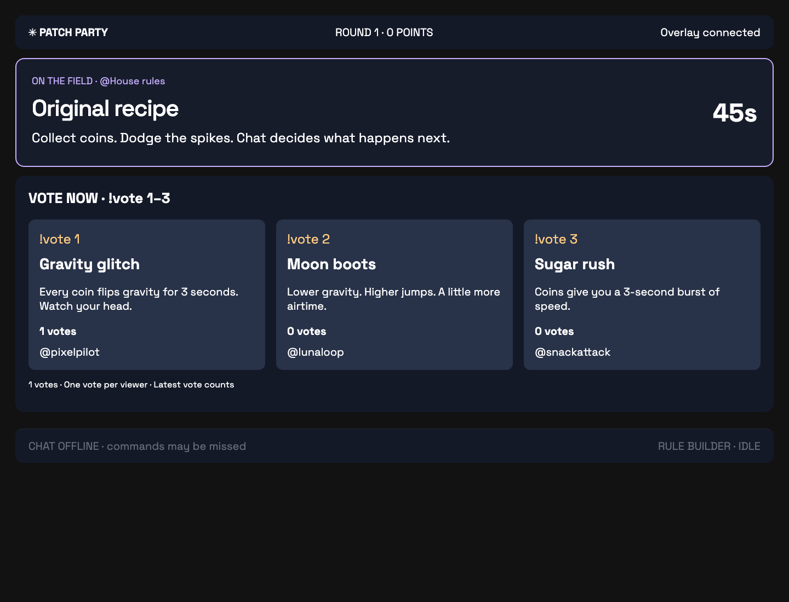

# Twitch and OBS integration

The user confirmed completing live Twitch/OBS verification on October 30, 2026. Automated tests below use mocked Twitch responses and are separate from that user-reported live verification.

## Register the Twitch application

1. Sign into the [Twitch developer console](https://dev.twitch.tv/console/apps) with the broadcaster account. Verify email and enable two-factor authentication first.
2. Choose **Register Your Application**, use a unique name (for example, Patch Party plus your channel name), and choose **Application Integration**.
3. Choose **Confidential** as the client type. This local app has a Node server that stores the client secret and exchanges authorization codes.
4. Add the exact OAuth redirect URL `https://127.0.0.1:5173/api/twitch/callback`, then create the application.
5. Open **Manage**, copy the client ID, and generate a client secret. Put them into the local `.env` file; do not put them in frontend code or commit them.

The application requests only `user:read:chat`. The broadcaster signs in as themselves, and both the subscribing user and channel are that account. This implementation reads chat commands; it does not send bot messages. A bot account, chat-write scope, or viewer logins inside Patch Party are unnecessary.

## Local setup and sign-in

From the repository root:

```sh
cp .env.example .env  # only if you do not already have .env
chmod 600 .env
# Edit TWITCH_CLIENT_ID, TWITCH_CLIENT_SECRET, and optionally TWITCH_BROADCASTER_LOGIN.
npm install
npm run setup:https
npm run dev
```

`npm run setup:https` generates a self-signed, 30-day development certificate in ignored `.local/https/`. It does not change system trust settings. On the first visit, your browser may require **Advanced → Proceed** for this local certificate. Only make that exception for your own local Patch Party server. For a browser-trusted certificate, replace these two PEM files with a certificate/key from your local development CA.

Use `127.0.0.1` consistently instead of mixing it with `localhost`. The origin, browser URL, and registered redirect URI must agree. Restart the server after editing `.env`.

Open the **operator link printed in the terminal**. It includes a random operator key in the URL fragment, which is removed from the address bar after sign-in. You can also enter the key on the login page. The operator cookie is HttpOnly and SameSite=Strict, expires after 12 hours, and is valid only until server restart. An optional `PATCH_PARTY_OPERATOR_KEY` can provide a stable startup key (at least 24 random characters).

In **Twitch control room**, click **Connect Twitch**, authorize the broadcaster account, and wait for **CONNECTED**. The panel shows the channel, most recent EventSub frame, reconnect count, and any unreplayed gap. When Twitch is connected or reconnecting, simulated inputs are disabled so a rehearsal cannot be mistaken for live viewer participation.

Tokens remain on the server in ignored `.local/twitch.json`, with owner-only file permissions. They restore on startup, validate on startup and at least hourly, refresh before expiry or on a 401, and persist rotated refresh tokens. Disconnect stops chat, attempts revocation at Twitch, and clears local credentials. Twitch-side revocation requires sign-in again. Client credentials and OAuth tokens never enter the frontend or generated-rule worker.

## OBS setup

Install [OBS Studio](https://obsproject.com/) if needed.

1. In OBS **Settings → Stream**, choose Twitch and connect the broadcaster account. Do this in OBS; Patch Party never needs a stream key.
2. Open the authenticated operator page in a normal browser and focus the arena. Add an OBS **Window Capture** (macOS may label it **macOS Screen Capture**) for that browser window. Crop to the game viewport so the operator controls, address bar, and terminal are outside the broadcast. Grant macOS Screen Recording permission if requested.
3. Add a **Browser Source** named Patch Party Overlay with URL `https://127.0.0.1:5173/overlay`, width **1920**, height **1080**, and **30 FPS**. The background is transparent. Place or crop the overlay beside/below the captured arena as desired. The responsive layout also supports narrower source widths.
4. The overlay shows the current rule and author, timer, ballot commands/counts, chat state and build stage. It has no game simulation and cannot become the controller. It needs no operator key or Twitch credentials. Keep it on the local machine; the server binds only to loopback.
5. Record a local rehearsal first. Verify rule text, `!rule`/`!vote` instructions, and author names are readable in the captured output. Then start the Twitch test stream yourself in OBS.

A Browser Source pointed at `/overlay` is **not** the playable arena. Do not point an OBS source at the authenticated operator URL. Use Window Capture for the game and the read-only Browser Source for broadcast information.

## Live milestone acceptance

1. Start an OBS recording and Twitch stream. Open the operator link, connect Twitch, select **Live Codex**, and reset to a clean lobby if needed. Reset keeps the Twitch connection but clears local verification evidence.
2. Have two distinct viewer accounts (other than the broadcaster) open the channel on Twitch. In the lobby, have them nominate supported rules with `!rule gravity` or `!rule moon`. Custom proposals use the bounded language shown in the Rule Workshop.
3. Start a round. Both viewers vote with `!vote 1` (or other slots). Have one change their vote, then change it back; the total should remain two. Lock the vote and confirm later votes are rejected in the operator feed.
4. Wait for a **new live Codex build** to reach READY. Finish the round, activate the rule, collect a coin, and verify the generated effect in the game and the OBS recording. A saved-library fallback is useful for recovery but does not establish a new live Codex build.
5. Open **View live test evidence** in the control room and save the JSON. It contains Twitch message IDs and viewer IDs, accepted vote receipts, lock observation, generated artifact hash/effect observation, and a current Twitch stream-live check. It never includes credentials. Review the OBS recording separately; `broadcastCaptureReviewed` remains false because the server cannot inspect a broadcast.
6. Test **Reconnect chat** during an open ballot and have viewers resend fresh commands after reconnection. Confirm one latest vote per viewer and no duplicated totals. The automated suite separately tests Twitch's seamless reconnect handoff, duplicate redelivery, and keepalive expiry.
7. Stop the stream and recording in OBS. Keep a short evidence recording and the JSON report for milestone review.

Twitch-initiated handoff retains subscriptions and keeps the old socket until the new welcome arrives. A dropped socket instead creates a fresh session and subscription, with exponential retry. **Twitch does not replay messages sent during a disconnection.** Viewers must resend after the connection returns; do not claim those messages were recovered. Duplicate chat-message IDs remain suppressed across reconnects and game resets. Proposals are capped at one per user per three seconds; viewer text is bounded before it reaches the common Party handlers.



This preview comes from the simulated-chat browser test, not a live Twitch broadcast.

## Validation and boundaries

```sh
npm test          # domain, isolation, OAuth, token rotation, EventSub, server authorization
npm run build
npm run test:e2e  # authenticated gameplay, login, no-controller/no-canvas OBS overlay
```

Automated verification on October 30, 2026 (America/Denver): **46 tests**, production build, and **5 browser tests**. Test files run sequentially to keep parallel host startup from distorting the rule runner’s strict execution deadlines.

The automated Twitch tests use injected HTTP responses and EventSub sockets. They cover two distinct Twitch identities flowing into real Party handlers, vote changes, deduplication across handoff, cold reconnection and resubscription, missed keepalives, revocation, token refresh single-flight/rotation, disconnect during refresh, OAuth state/cookie replay protection, and authorization boundaries. Browser tests verify the overlay stays read-only and contains no canvas even when opened before the controller.

Local implementation uses loopback HTTPS with origin checks and HttpOnly, Secure cookies. The backend proxy hop remains on loopback HTTP. This is not a remotely hosted deployment. Public hosting would require HTTPS, secure cookies, and an appropriate deployment/authentication design.

## References

- [Twitch app registration](https://dev.twitch.tv/docs/authentication/register-app/)
- [OAuth authorization-code flow](https://dev.twitch.tv/docs/authentication/getting-tokens-oauth/#authorization-code-grant-flow)
- [Installed chatbot authorization](https://dev.twitch.tv/docs/chat/authenticating/)
- [Token validation](https://dev.twitch.tv/docs/authentication/validate-tokens/)
- [Token refresh](https://dev.twitch.tv/docs/authentication/refresh-tokens/)
- [EventSub WebSocket lifecycle](https://dev.twitch.tv/docs/eventsub/handling-websocket-events/)
- [Chat message subscription](https://dev.twitch.tv/docs/eventsub/eventsub-subscription-types/#channelchatmessage)
- [OBS Browser Source](https://obsproject.com/kb/browser-source)
