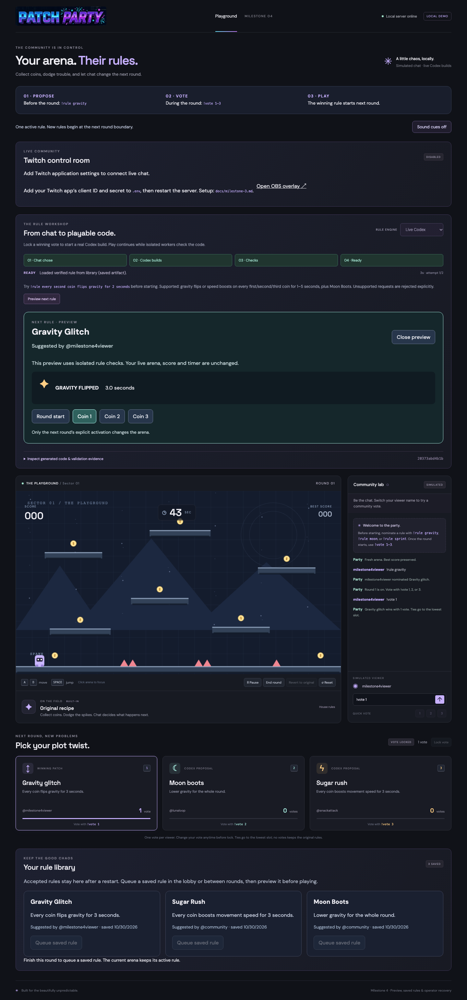

# Milestone 4: presentation and operator recovery

Implemented and verified October 30, 2026 (America/Denver).

## Preview, activate and revert

1. When a live build or saved fallback is READY, choose **Preview next rule**. Switch between **Round start** and **Coin 1–3** to inspect the isolated runner's actual commands and effect duration. The preview does not change the active artifact, score, timer or live effects.
2. Close the preview. Finish the current round, then choose **Play next round**. The three-second reveal shows the accepted rule and its credited author before gameplay starts. A queued saved rule in the lobby uses the same reveal when **Start round** is pressed.
3. Use **Revert to original** at any time to restore original physics and clear active effects. Score and round time are preserved. Stale worker results cannot reapply an effect after revert. Revert changes the active rule; a separate queued rule for the next round remains available.
4. **Pause** freezes the round timer and effect expiry. **Reset** returns to a clean lobby, preserving best score, the selected engine, saved rules and the Twitch connection.

## Recover without restarting OBS or the app

- A failed or cancelled build offers **Retry build** and **Use saved rule · library**. A missing matching fallback produces an actionable error instead of a silent no-op.
- **Cancel build** stops an in-progress build. A timeout or generator crash cannot trap the coordinator; retry remains available.
- Between rounds, use **Skip rule · play original** to continue with original physics.
- Open **Your rule library** to queue a different saved rule in the lobby or results screen. Every selected rule is validated again. Queueing never changes the active arena in the middle of a round. A queued lobby rule can be removed with **Cancel queued rule**.
- The read-only OBS overlay remains connected throughout these controls. It shows the next rule and author, explains whether chat chose it or the streamer selected a saved rule, and displays recovery status when generation fails.

## Saved rules and restart behavior

Accepted artifacts and credited author/proposal records are written atomically to ignored `.local/rule-<hash>.json` files with owner-only permissions. The library displays up to 20 recent entries. Best score and engine preference are stored in `.local/lobby.json`; the server does not persist in-progress rounds, votes, effects, active artifacts or preview state.

After restarting the app, open the new operator link printed in your terminal. The app starts in a **fresh lobby** with original physics and no stale ballot or build. Your saved library, best score and engine choice remain available. Twitch authorization restoration remains independent of game restoration.

Earlier accepted files in `artifacts/rules/` are imported on startup after hash, intent, language and behavioral checks; original files are not modified. Earlier records without author metadata are labeled `community` rather than assigned an invented original author. Newly accepted records keep the proposing viewer's credit across restart and library reuse. Loaded artifacts are explicitly labeled **Saved rule · library**.

Corrupt rules are skipped and reported; they do not prevent a clean lobby or other valid saved rules from loading. A failed write leaves original gameplay available and exposes retry/skip recovery instead of activating an unsaved rule. `PATCH_PARTY_DATA_DIR` can select a different private data directory; it defaults to `.local`.

## Broadcast presentation

The operator page and OBS overlay explain participation in plain language: propose before the round with `!rule gravity`, vote during the round with `!vote 1–3`, and play the winning rule next round. Cards display vote totals and viewer credit. The reveal repeats the author credit. A streamer-selected saved rule is labeled separately from a winning vote.

**Sound cues off** is the default. Click it to opt into short cues for reveal, readiness and failures. Sound starts only after the operator clicks the control; the OBS overlay never autoplays duplicate audio. Reduced-motion preferences suppress decorative transitions and arena flashes/shakes.

## Verification

- **56 unit/integration tests**: artifact persistence and tampering checks; legacy migration; clean restart with credited saved-rule reuse; preview isolation; stale-effect rejection after revert; timeout retry when a generator ignores abort; synchronous generator failure; disk-save failure with skip recovery; existing gameplay, OAuth, Twitch and execution isolation regressions.
- **6 HTTPS browser tests**: login, controller/overlay separation, samples, generated/saved artifact activation, and a complete milestone 4 recovery walkthrough. Twitch and failed generation are deliberately mocked in these repeatable tests; they are not presented as fresh live Twitch/Codex evidence.
- **Production build**: TypeScript check and Vite bundle.

Run from the repository root:

```sh
npm test
npm run build
npm run setup:https
npm run test:e2e
```

For the full HTTPS browser run, stop your local development server first, then use:

```sh
PATCH_PARTY_TEST_ORIGIN=https://127.0.0.1:5173 npm run test:e2e
```

Tests use their own private state directory and do not change your Twitch credentials. The browser preview screenshot below comes from the offline recovery walkthrough.


